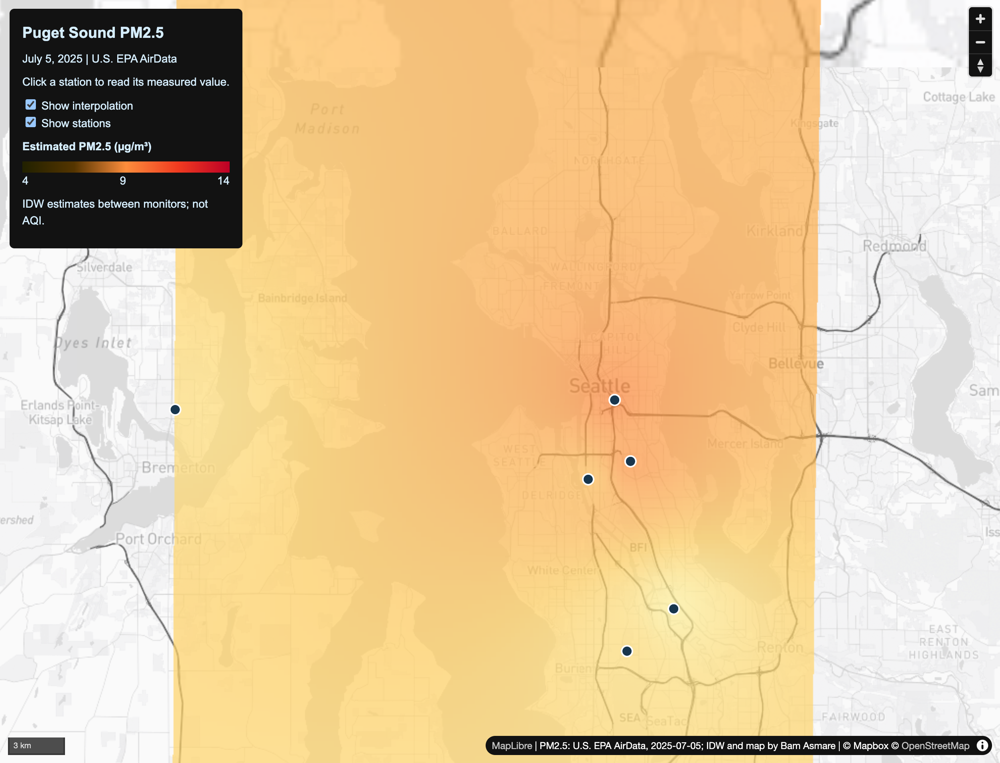
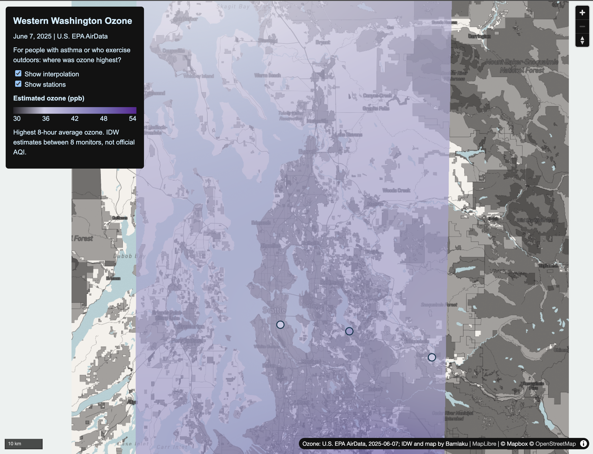

# Lab 3: Tile Maps (GEOG 458)

Author: Bamlaku (UW). Both maps use MapLibre GL JS with pre-rendered PNG tiles (XYZ, 256 px) and no Mapbox token in the page.

Live pages:
- Guided: https://bamlaku7.github.io/geog458new/lab3/bamasmare_lab3-1.html
- Independent: https://bamlaku7.github.io/geog458new/lab3/bamasmare_lab3-2.html

## Map 1: Puget Sound PM2.5 (guided)

Purpose: show where fine particle pollution was highest around Seattle on July 5, 2025.
Study area: central Puget Sound, west -122.75, east -122.05, south 47.10, north 48.15. Tile zoom 8 to 12.

Sources: U.S. EPA AirData daily PM2.5 (parameter 88101), 11 monitoring sites, units µg/m³. Basemap © Mapbox © OpenStreetMap.

Processing:
1. Designed a Mapbox Studio basemap (five commercial POI classes removed, darker freeways) and exported it from QGIS with QMetaTiles to `assets/mapbox-guided`.
2. Loaded the 11 stations in QGIS, saved them in UTM zone 10N, and ran IDW interpolation (P = 2, 250 m pixels).
3. Styled the raster from 4 to 14 µg/m³ in five yellow-to-red classes and exported it separately to `assets/pm25-guided`.
4. Added the stations as a GeoJSON layer with popups (name, measured value, date, ID).

Estimates versus measurements: the colored surface is an IDW estimate between monitors. The dots and popups are the measured values.

## Map 2: Western Washington ozone (independent)

Purpose: help people with asthma and people who exercise outdoors see where ozone was highest on June 7, 2025.
Study area: western Washington, west -123.0, east -121.5, south 46.65, north 49.05. Tile zoom 8 to 11.

Sources: U.S. EPA AirData daily ozone (parameter 44201, `daily_44201_2025`), highest 8-hour running average, converted from ppm to ppb. 8 monitoring sites. Basemap © Mapbox © OpenStreetMap.

Processing:
1. Filtered the EPA file to Washington, the study area, one date, one site per row, at least 75% observations (`data/o3_source.json` has the details).
2. Loaded the 8 stations in QGIS and saved them in UTM zone 10N (`data/03_utm10.gpkg`).
3. Interpolated with IDW (P = 2, 250 m pixels), 30 to 54 ppb in five light-to-dark purple classes.
4. Exported the ozone surface separately, with transparent empty areas, to `assets/o3-independent` (zoom 8 to 11).
5. Exported a second Mapbox Studio basemap to `assets/mapbox-independent` with QMetaTiles (PNG, XYZ, zoom 8 to 11).
6. Added the stations from `data/o3_stations.geojson`. Dot color follows the measured value, and clicking a dot shows its name, ozone in ppb, date and station ID.

Second basemap: a separate Studio style (lab3-ozone-bamasmare) with the five commercial POI classes removed, a warm gray land color and a blue-gray water color.

Estimates versus measurements: the purple surface is an IDW estimate from only 8 monitors. It is not a measurement and not an official air-quality assessment. The dots and popups are the measured values.

## Files

- `data/`: station CSV and GeoJSON files and source notes for both maps.
- `assets/`: four tile pyramids: `mapbox-guided`, `pm25-guided`, `mapbox-independent`, `o3-independent`.
- `README_provided_data_notes.md`: the original notes that came with the PM2.5 data.
